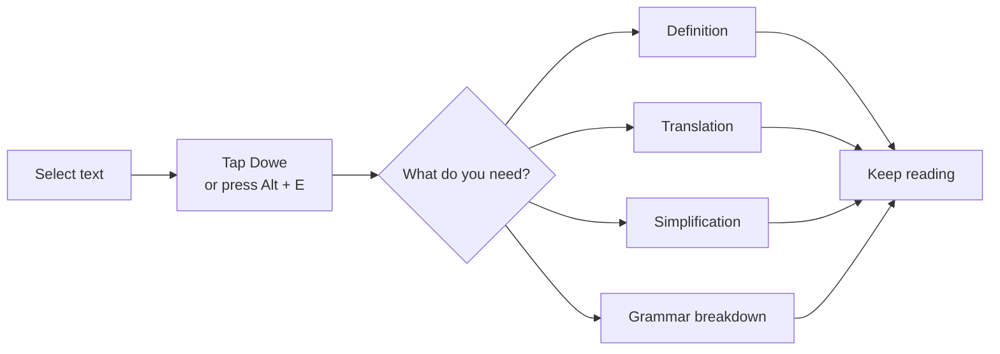

<p align="center">
  <picture>
    <source media="(prefers-color-scheme: dark)" srcset="icons/logo-dark.svg" />
    
  </picture>
</p>

<h1 align="center">Dowe</h1>

<p align="center">
  <strong>Understanding, delivered instantly.</strong>
</p>

<p align="center">
  An AI reading companion for Chrome and Microsoft Edge.
  Select text, tap Dowe, and keep reading.
</p>

<p align="center">
  Define &nbsp;·&nbsp; Translate &nbsp;·&nbsp; Simplify &nbsp;·&nbsp; Understand grammar
</p>

---

[**Download the extension ZIP**](https://github.com/dsahakyan15/Dowe/archive/refs/heads/web/prod.zip)
&nbsp;·&nbsp;
[Installation](#install-in-chrome-or-microsoft-edge)
&nbsp;·&nbsp;
[Browse the extension](https://github.com/dsahakyan15/Dowe/tree/web/prod)

## Read. Select. Understand.

Dowe explains unfamiliar words, translates phrases, simplifies dense writing, and
breaks down grammar beside the text you selected. Highlight a word, sentence, or
paragraph, then tap the floating Dowe icon or press **Alt + E**.



## Four ways to understand a passage

| | Mode | Best for |
|---|---|---|
| 💡 | **Define** | Understanding unfamiliar words and concepts in context |
| 🌍 | **Translate** | Reading naturally across languages |
| ✨ | **Simplify** | Turning dense writing into clear, approachable language |
| 🧩 | **Grammar** | Seeing how a phrase is built and why it works |

Switch between **Simple** and **Technical** answers. Choose from 12 answer
languages: English, Russian, Armenian, Spanish, French, German, Italian, Portuguese,
Chinese, Japanese, Korean, and Arabic.

## A dictionary that grows with you

Lookups are saved in your local dictionary so you can return to what you learned:

- Search and filter previous explanations.
- Star entries and see which terms you look up most often.
- Re-run a lookup for a fresh answer.
- Export entries as a glossary and import a shared glossary in Settings.

Matching glossary entries can answer a lookup locally before an AI request is made.

## Built for real reading

- **Stay in the flow.** Answers appear beside the text you selected.
- **Choose your appearance.** A minimal lavender interface with light, dark, and
  system themes.
- **Use your keyboard.** Start a lookup with `Alt + E`.
- **Control where it runs.** Disable Dowe on individual sites.

## Install in Chrome or Microsoft Edge

Dowe is available as an unpacked extension in early preview.

1. [Download the extension ZIP](https://github.com/dsahakyan15/Dowe/archive/refs/heads/web/prod.zip) and extract it.
2. Open `chrome://extensions` or `edge://extensions`.
3. Enable **Developer mode**.
4. Choose **Load unpacked** and select the extracted folder containing `manifest.json`.
5. Follow the welcome screen to choose your AI provider, enter your API key, and
   test the connection.

Open a regular webpage, select some text, and tap the Dowe icon or press `Alt + E`.

To update an unpacked installation, replace its files with the latest download
and click **Reload** on the browser's extensions page.

> Browser-internal pages and extension stores do not allow content extensions to
> run. AI answers can be inaccurate; verify important information with a trusted
> source.

## Bring the AI you trust

Dowe works with your own provider account:

- Anthropic (Claude)
- OpenAI
- Google Gemini
- Custom OpenAI-compatible endpoints

Use your own API key. You choose the provider, model, answer language, and answer
level. Provider usage fees may apply. No Dowe account is required.

## Private by design

Dowe has no analytics, telemetry, advertising, or first-party backend.

Settings, API keys, dictionary entries, and imported glossaries stay in your
browser. When a lookup needs AI, the selected text, surrounding sentence, and
provider credentials go directly to the provider you configured. Requests never
pass through a Dowe-owned server.

## About this repository

This repository contains the browser extension. The `main` and `web/prod` branches
contain the current published extension source.

```text
manifest.json    Chrome / Edge Manifest V3
src/            Background worker, page popup, dictionary, and settings
icons/          Current Dowe logo and light / dark browser icons
```

The extension uses plain JavaScript, HTML, and CSS. No build step is required to
load it in the browser.

---

<p align="center">
  <strong>Dowe — understanding, delivered instantly.</strong>
</p>
